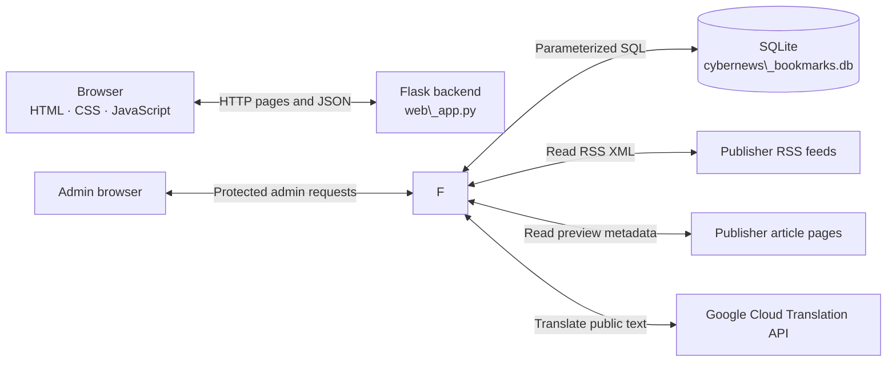
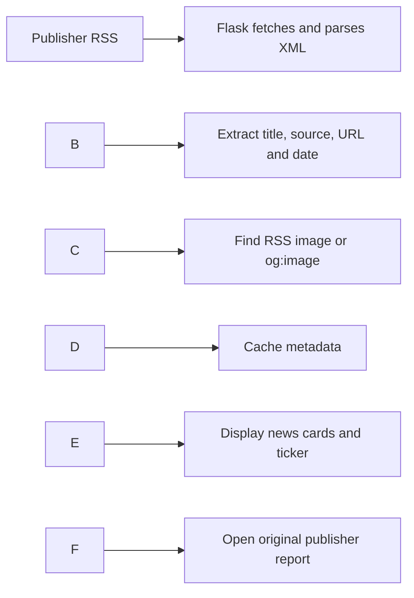
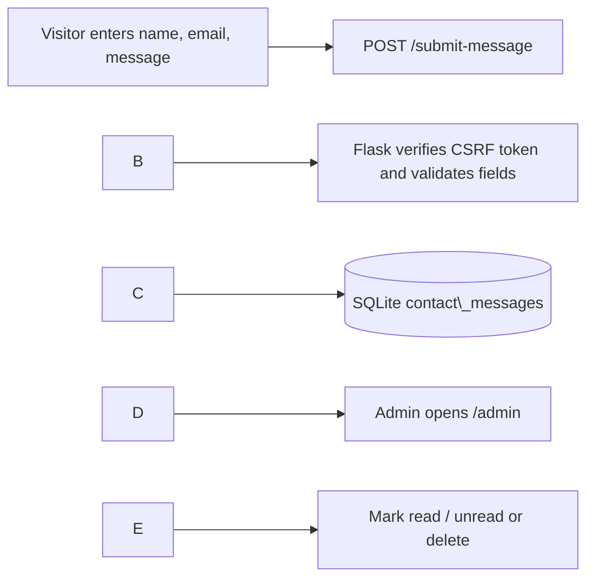
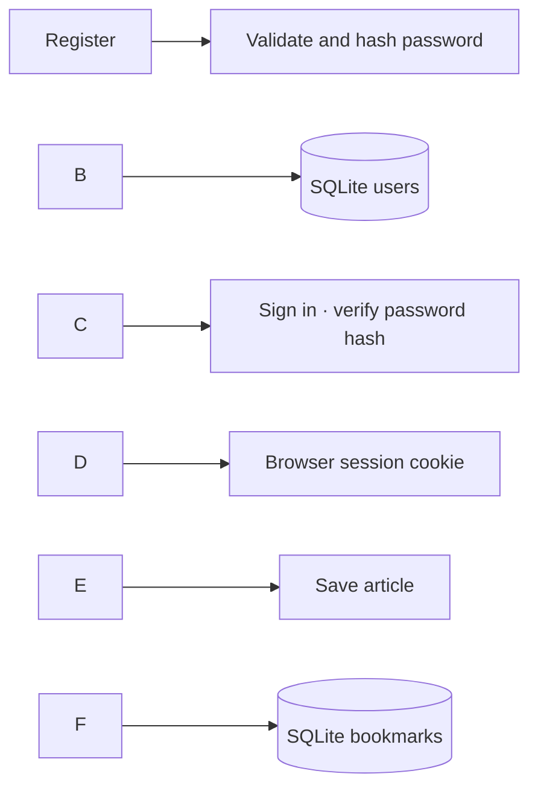
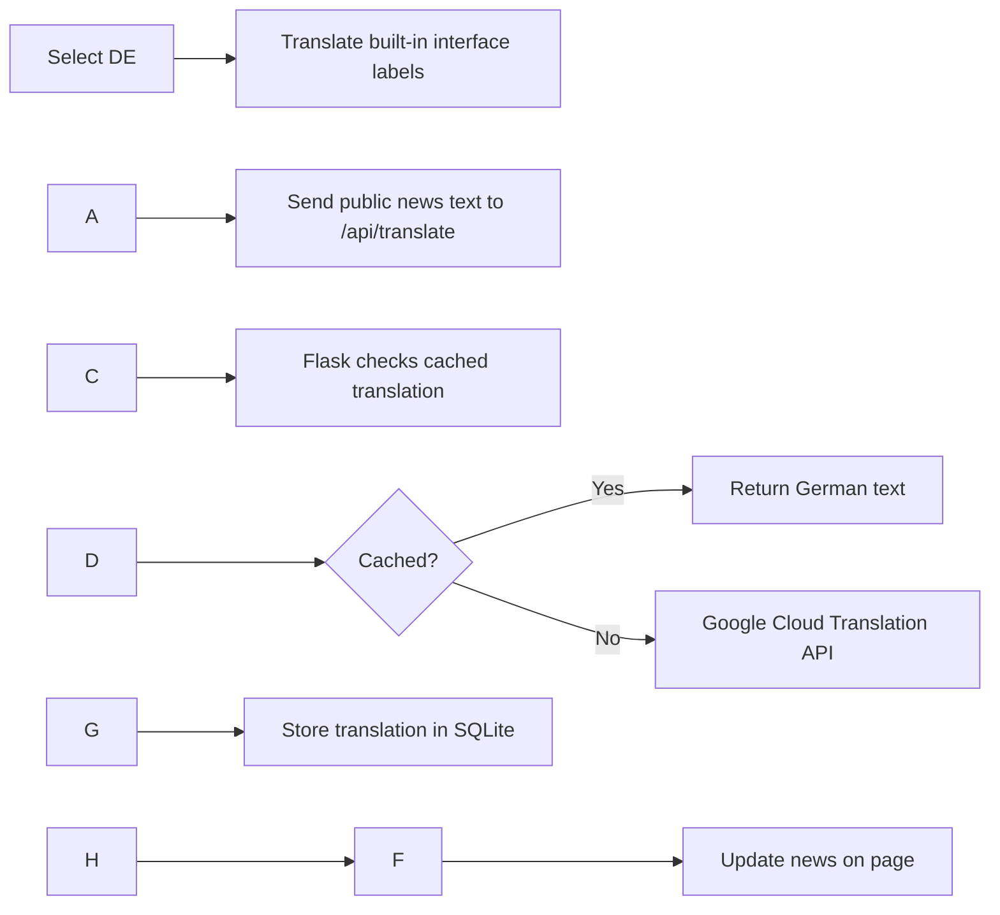

# CyberNews Tracker

**A cybersecurity news website built with Python, Flask, SQLite, HTML, CSS, and JavaScript.**

CyberNews Tracker brings headlines from established cybersecurity publishers into one responsive news reader. Visitors can discover and filter stories, read the original reporting, and switch the interface between English and German. Registered members can save articles, while administrators can manage user access and review messages submitted through the Contact form.

**Developed by Shekoufeh Neisarian**  
**Source code:** https://github.com/Shekoufeh-Neisarian/CyberNews-Tracker

> \*\*Running the project:\*\* This repository contains a locally runnable Flask application, not a publicly hosted website. Follow the steps below, start `python web\_app.py`, and open `http://127.0.0.1:5000` in your own browser.

## Project structure

This is the folder structure of the submitted application. Keep the `templates/` and `static/` folders in these locations so Flask can find the pages and assets.

```text
CyberNews-Tracker/
├── web\_app.py                       # Flask backend: routes, APIs, news, forms and sessions
├── cybernews\_bookmarks.db           # SQLite demonstration data (review before publishing)
├── requirements.txt                # Python dependency: Flask
├── README.md                       # Installation, architecture and user guide
├── LICENSE                         # Repository license
├── .gitignore                      # Ignore local environments and secrets
├── .env.example                    # Placeholder variable names, no real API key
├── templates/                      # HTML/Jinja pages (13 files)
│   ├── base.html                   # Shared layout, navigation, languages and cookie banner
│   ├── index.html                  # Home and featured news
│   ├── news.html                   # Latest News and category filtering
│   ├── login.html                  # Sign in
│   ├── register.html               # Sign up
│   ├── user\_dashboard.html         # Member account activity
│   ├── admin\_dashboard.html        # Roles, login statistics and Contact inbox
│   ├── bookmarks.html              # Saved articles
│   ├── contact\_form.html           # Visitor feedback form
│   ├── confirmation.html           # Contact submission confirmation
│   ├── access\_denied.html          # 403 permission-denied page
│   ├── intelligence.html           # Separate protected-API classroom exercise
│   └── cookie\_check.html          # Separate HttpOnly cookie classroom exercise
├── static/
│   ├── style.css                   # Responsive layout and light/dark styles
│   ├── script.js                   # News interactions, ticker, theme and progress bar
│   ├── language.js                 # Language support from earlier implementation
│   ├── language.css                # Language-related styling
│   └── images/
│       └── cyber-hero.svg          # Globe/network artwork for Latest News
├── docs/
│   ├── architecture-and-features.png
│   └── WORKFLOWS\_AND\_DEMO.md
└── screenshots/
    ├── 01-home-dark.png  …  13-contact-form.png   # 13 real website screenshots
    └── README.md                   # Screenshot descriptions
```

The `intelligence.html` and `cookie\_check.html` files remain because we kept their educational Flask routes. They are separate demonstrations; the main news site, consent banner and account security work independently of those pages.

### Main application files explained

|File/folder|What it does|
|-|-|
|`web\_app.py`|Processes HTTP requests; reads RSS feeds; validates forms; checks accounts and permissions; communicates with SQLite and Google Translation.|
|`templates/`|Renders the browser pages using HTML and Jinja. `base.html` supplies the common header, navigation and footer.|
|`static/`|Contains browser-side CSS, JavaScript and the cyber-globe SVG.|
|`cybernews\_bookmarks.db`|Holds the local demo users, bookmarks, login events, Contact messages and caches.|
|`docs/`|Stores architecture visual and step-by-step workflow guide.|
|`screenshots/`|Shows the actual website in English/German and light/dark mode, including user and administrator views.|

## Quick start — Windows

### Requirements

* **Python 3.10 or newer** and **Git**
* An internet connection for the live RSS news feeds
* A web browser such as Chrome, Edge, or Firefox
* PowerShell (the example commands below are for Windows)

### 1\. Clone the GitHub repository

```powershell
git clone https://github.com/Shekoufeh-Neisarian/CyberNews-Tracker.git
cd CyberNews-Tracker
```

### 2\. Create a Python virtual environment

```powershell
python -m venv .venv
.\\.venv\\Scripts\\Activate.ps1
```

If PowerShell blocks activation, use `.\\.venv\\Scripts\\python.exe` instead of `python` in the next commands; activation is not required.

### 3\. Install the required package

```powershell
python -m pip install -r requirements.txt
```

The main external Python package is **Flask** (which also installs Werkzeug). RSS parsing, SQLite, HTTP requests, and other supporting functionality use Python's standard library.

### 4\. Start the web application

```powershell
python web\_app.py
```

When the terminal displays `Running on http://127.0.0.1:5000`, open:

`http://127.0.0.1:5000`

Leave PowerShell running while you use the website. Press **Ctrl+C** to stop the Flask server.

### 5\. Try the demonstration accounts

When starting from a **new database**, the application creates these local classroom accounts. An existing demonstration database may contain updated account records or passwords:

|Access|Username|Password|Where it leads|
|-|-|-|-|
|Regular member|`user`|`user123`|Personal dashboard and bookmarks|
|Administrator|`admin`|`admin123`|Admin Console, account management, and Contact inbox|

You can also register a new account using **Join**. New registrations receive regular user access; administrators control any later role changes. The demonstration credentials are for **local educational testing only**.

### About the SQLite database

CyberNews uses **`cybernews\_bookmarks.db`**, located next to `web\_app.py`.

* **If a demonstration database is included in the repository:** Flask opens and reuses that file, including its demonstration records.
* **If the file is absent:** Flask automatically creates the database and its required tables when the application starts.
* Registered accounts, bookmarks, login history, contact messages, RSS metadata, and cached translations persist in this file between server restarts.
* Login **session tokens** are held in server memory, so signing in again after restarting Flask may be necessary.

If preparing a public GitHub copy of this database, use **demonstration data only**: remove private visitor messages, personal addresses, non-demo accounts, and any sensitive records before committing it. Even hashed passwords are account data. A record removed in a later commit can remain in Git history.

\---

## Project overview

CyberNews uses two complementary news pages:

|Area|What visitors see and do|
|-|-|
|**Home** (`/`)|A featured headline, latest-story cards, a news-wire sidebar, and shortcuts to explore more articles.|
|**Latest News** (`/news`)|An expanded feed of up to 36 RSS stories, with a search field, topic filters, publisher images, bookmarking and RSS refresh.|
|**Search**|Search or filter available news by keywords, publisher, or topic.|
|**Join / Sign in**|Create an account or authenticate as an existing user.|
|**My Account** (`/dashboard`)|View your profile, membership date, saved-article total, and successful sign-in history.|
|**Bookmarks** (`/bookmarks`)|Review, search and remove articles saved to your personal reading list.|
|**Contact** (`/contact`)|Submit feedback with your name, email address and message.|
|**Admin Console** (`/admin`)|Manage user roles and titles, inspect login statistics and review submitted Contact messages.|

News stories are sourced from publisher feeds and link to the **original publisher articles**. The application's RSS cache contains article metadata rather than copies of the complete publisher articles.

## Features

### News, article discovery and images

* Read real cybersecurity headlines from **The Hacker News, SecurityWeek, BleepingComputer, and Krebs on Security**.
* Show headline, source, publication date, original article link, and preview image when available.
* Present a featured Home story, additional highlights, and an extended **Latest News** collection.
* Search by headline or publisher and filter by categories such as **Vulnerabilities**, **Ransomware**, **Malware**, **Data Breaches**, and **AI Security**.
* Use images supplied in RSS feeds; when missing, attempt to read a publisher's public article-page **`og:image`** preview metadata. Display a fallback when a usable image is unavailable.
* Display publication times in **Europe/Berlin**, including daylight-saving changes.
* Use a **Refresh RSS** control; the backend ordinarily caches the feed for about **15 minutes** to avoid unnecessary repeat requests.
* Animate a **live headline ticker** along the top of the website. The application also exposes an RSS XML endpoint at `/rss`.

### Accounts, personal reading lists and administration

* Register, sign in and sign out of local accounts.
* Store password **hashes** rather than plaintext passwords.
* Use authenticated sessions for member features; new accounts are created as regular users.
* Save and remove articles in a **per-user SQLite bookmarks table**.
* Show registration time, profile title, access role, sign-in history, and bookmark count in the **My Account** dashboard.
* In the **Admin Console**, see registered members, login counts and recent sign-in events.
* Change **access role** (`user` / `admin`) separately from **professional title** (for example Student, Researcher, Teaching Assistant, Professor, or Security Analyst).
* Read and manage Contact submissions through an admin-only inbox: **Mark read**, **Mark unread**, and **Delete**.

### Interface, languages and privacy controls

* Responsive, cybersecurity-themed pages designed with **HTML/Jinja, CSS, and JavaScript**.
* **Light and dark themes**; the theme selection is restored during page navigation using cookie/session-storage logic.
* **EN/DE language selector**: predefined interface labels are localized in the browser; dynamic public news text is translated through the Flask/Google Cloud integration when configured.
* **Cookie consent banner** with **Essential only** and an optional theme preference.
* A selected theme can persist within the current browser tab; with optional consent, a theme cookie can remember the choice across sessions.
* **Colorful scroll-progress bar** at the top of the page: **pink → purple → blue → turquoise → mint green**. JavaScript updates its filled width according to scroll position.
* Live headline ticker, cyber-globe/network hero artwork, responsive article cards, and light/dark controls.

## Architecture and technologies

The application follows a simple **browser → Flask → data/services** design. The flowchart below is the accurate reference for component names and data flow. The accompanying [architecture infographic](docs/architecture-and-features.png) is a visual overview; its exported image still abbreviates the database name as `cybernews.db` and describes the progress bar as article-only. In the running app, the database is **`cybernews\_bookmarks.db`** and the progress bar is part of the shared site layout.



|Layer|Main tools|Responsibility|
|-|-|-|
|**Frontend**|HTML, Jinja templates, CSS, JavaScript|Page layout, news cards, search/filter controls, themes, translations, ticker and scroll bar.|
|**Backend**|Python, Flask, Werkzeug|Routing, RSS processing, sessions, access checks, input validation, API requests and form handling.|
|**Database**|SQLite|Local account data, login events, bookmarks, Contact messages, RSS metadata and translation cache.|
|**News sources**|Publisher RSS feeds / article metadata|Cybersecurity headlines, dates, source links and preview-image URLs.|
|**Translation**|Google Cloud Translation Basic v2|English-to-German translation of selected dynamic text through Flask.|

**Why Flask?** Flask connects the pages to Python functions. When the browser visits `/news`, submits a form, or requests JSON, Flask decides what processing to perform and which result to return.

**Why SQLite?** SQLite provides persistent, file-based tables without requiring a separate database server. Flask uses SQL queries to store and retrieve accounts, bookmarks and submitted messages.

## How the main workflows work

### 1\. RSS headline → news card



The application uses curated publisher feeds rather than arbitrary URLs submitted by visitors. A real article image is used where its metadata permits; otherwise the card shows a fallback. The user opens the full article on the publisher's site.

### 2\. Contact form → database → Admin Inbox



**In practical terms:**

1. The visitor opens **Contact** and fills in **name**, **email**, and **message**.
2. Flask checks the form token and input values, including required fields and length limits.
3. Valid entries are stored in `contact\_messages` with a UTC timestamp and default **unread** status.
4. The visitor sees a confirmation page.
5. A signed-in **administrator** opens the Admin Console to view the sender and message, mark it read/unread, or delete it.

The Contact form **stores messages locally in SQLite**. It does not send a notification email automatically.

### 3\. Registration, login, roles and bookmarks



A user's **professional title** describes them, whereas their **access role** controls permissions. Being called *Professor* or *Researcher* does **not** grant administrator access. Flask checks the user's actual role when loading the Admin Console or processing its actions.

### 4\. EN/DE language switching



The **Google API key stays on the Flask side** in an environment variable. Visitors' private account records and Contact messages are not part of the public news translation workflow. Selecting **EN** restores the original English copy.

### 5\. Theme choice, cookie consent and scroll progress

* **Essential cookies** support the login session and necessary consent/form behavior.
* The visitor can choose **Essential only** or allow the optional **theme preference cookie**.
* For Essential-only visitors, **sessionStorage** can keep the chosen theme during navigation within the same browser tab.
* If optional preferences are allowed, the theme cookie can remember the chosen appearance across browser sessions.
* The **scroll-progress bar** uses a CSS gradient and JavaScript scroll-position calculation; it shows the portion of the current page already traversed.
* The **headline ticker** is a different feature: it horizontally displays publisher headlines from the RSS data.

## SQLite database

**File:** `cybernews\_bookmarks.db` (in the repository root, beside `web\_app.py`).

|Table|Purpose|
|-|-|
|`users`|Username, display name, password hash, role, title, registration time and login counters.|
|`login\_events`|Persistent records of successful sign-ins.|
|`bookmarks`|Saved article metadata associated with an account.|
|`contact\_messages`|Visitor name, email, message, submission timestamp and read/unread status.|
|`rss\_cache`|Cached headline and publisher-preview metadata.|
|`translation\_cache`|Cached English-to-German public text translations.|

**Demo database for GitHub:** You can include a **sanitized copy** of `cybernews\_bookmarks.db` so an instructor can see example records immediately. It should contain only intentional demonstration accounts and messages. If no database is present after cloning, Flask creates the same table structure automatically.

If `.gitignore` excludes `\*.db`, deliberately stage the reviewed demo database with:

```powershell
git add -f cybernews\_bookmarks.db
```

Then review `git status` before committing. **Never commit your Google Cloud API key or `.env` file.**

## Security and privacy

The project demonstrates practical web security techniques in a **local learning application**:

|Technique|Where it is used|
|-|-|
|**Password hashing**|Werkzeug's `generate\_password\_hash()` and `check\_password\_hash()` for user passwords.|
|**Session-based authentication**|Browser cookie holds a random token; the session record is checked on the Flask server.|
|**Role-based access control**|Administrator routes and actions check the user's current role in SQLite.|
|**CSRF protection**|Form/request tokens for Contact submissions and relevant signed-in state-changing actions.|
|**Input validation**|Checks required fields, formats and length constraints on registration and Contact submissions.|
|**Parameterized SQL**|SQL placeholders (`?`) keep data values separate from SQL statements.|
|**HTML escaping**|Jinja templates escape submitted text when presenting messages.|
|**Cookie settings**|Authentication cookies use `HttpOnly` and `SameSite=Lax`; `Secure` can be enabled for HTTPS.|
|**Cookie consent**|Optional theme persistence is controlled by the visitor's choice.|
|**API key isolation**|Google credentials are supplied through a server-side environment variable.|

**Input validation explained:** When a visitor submits a Contact form, the application rejects empty or incorrectly formatted fields instead of storing them. For example, the message must have **5–5,000 characters**. Validation checks incoming data; password hashing, parameterized SQL, authorization, and escaping provide different protections.

The built-in demonstration accounts and Flask development server are intended for **local coursework**, not direct exposure to the public internet.

## Google Translate configuration

RSS news browsing and basic website navigation work without a Google API key. To enable live **German translation of dynamic news text**:

1. Create/select a Google Cloud project and enable **Cloud Translation API**.
2. Create an API key restricted to **Cloud Translation API**. Keep it private.
3. In the **same PowerShell window** used to run Flask, set:

```powershell
   $env:GOOGLE\_TRANSLATE\_API\_KEY = "YOUR\_OWN\_API\_KEY\_HERE"
   python web\_app.py
   ```

4. In CyberNews, select **DE** and check that an English news headline is translated.

The implementation uses **Google Cloud Translation Basic (v2)** via the Flask backend and caches translated text in SQLite. Using Google's API may count against your Cloud billing or trial credits. The interface includes built-in translated labels separately from this API.

Other configuration options:

|Variable|Effect|
|-|-|
|`GOOGLE\_TRANSLATE\_API\_KEY`|Optional API key for dynamic news translation.|
|`CYBERNEWS\_FETCH\_OG\_IMAGES`|Set to `0` to skip publisher-page `og:image` lookups.|
|`NEWS\_API\_KEY`|Optional NewsAPI classroom endpoint, separate from the primary RSS feed.|
|`COOKIE\_SECURE`|For local HTTP keep `0`; set `1` for a correctly configured HTTPS deployment.|
|`FLASK\_DEBUG`|Keep disabled (`0`) during regular demonstrations.|

## Screenshots

These images show the **actual local CyberNews website**, in English and German, light and dark mode, plus signed-in/member/admin pages. They are application screenshots—not screenshots from the AI-builder reference used during design. Private contact details were concealed in the public Admin Inbox screenshot.

### Home in dark and light mode

|Dark|Light|
|-|-|
|!\[CyberNews dark-mode homepage](screenshots/01-home-dark.png)|!\[CyberNews light-mode homepage](screenshots/04-home-light.png)|

The homepage features a main story, the RSS news wire and recent article cards.

!\[Additional news cards and publisher artwork](screenshots/02-home-dark-stories.png)

### Latest News with category filters and cyber-themed hero

!\[Latest News page with search, topic filters and publisher images](screenshots/06-latest-news.png)

### German translation

!\[German CyberNews homepage with translated headlines](screenshots/05-home-german.png)

### Sign in, bookmarks and member dashboard

|Sign in|Saved articles|
|-|-|
|!\[CyberNews sign-in page](screenshots/07-sign-in.png)|!\[Saved bookmark list](screenshots/08-bookmarks.png)|

!\[Member dashboard with login activity, registration date and saved news](screenshots/09-member-dashboard.png)

### Admin Console: user accounts and Contact inbox

!\[Administrator dashboard with access roles, profile titles and login counts](screenshots/11-admin-accounts.png)

|Visitor Contact form|Messages visible to administrators|
|-|-|
|!\[Contact form for submitting feedback](screenshots/13-contact-form.png)|!\[Admin Contact inbox with message management](screenshots/12-admin-contact-inbox.png)|

### Cookies, colorful scroll bar and footer

!\[Cookie consent and gradient scroll progress](screenshots/10-cookie-consent.png)

!\[Footer containing cookie settings link](screenshots/03-footer.png)

## Demonstration checklist

Use this sequence when presenting CyberNews to an instructor:

1. **Home:** Point out the featured story, publisher news wire and live headline ticker.
2. **Latest News:** Try search and topic filters; open an original publisher report and show its image preview.
3. **EN/DE:** Switch languages and explain built-in UI labels versus Google-backed public news translation.
4. **Interface:** Change light/dark mode, navigate to another page, show cookie choices and scroll down to demonstrate the **multicolor progress bar**.
5. **Member account:** Sign in, save an article, open Bookmarks, and check the My Account dashboard.
6. **Contact:** Send a short test message and confirm that it was accepted.
7. **Admin Console:** Sign in as a demo admin, locate the message, mark it read/unread, and optionally delete it. Show roles, titles and sign-in totals.
8. **Behind the scenes:** Explain how `web\_app.py`, `templates/`, `static/`, and the six SQLite tables fit together.

For a more detailed technical walkthrough, see [Workflows and demonstration notes](docs/WORKFLOWS_AND_DEMO.md).

## Troubleshooting

|Symptom|What to check|
|-|-|
|`ModuleNotFoundError: No module named 'flask'`|Use your `.venv` Python and run `python -m pip install -r requirements.txt`.|
|PowerShell refuses to activate `.venv`|Use `.\\.venv\\Scripts\\python.exe web\_app.py` directly.|
|Cannot open `127.0.0.1:5000`|Confirm Flask is running and that nothing else is using port 5000.|
|News does not load|Check internet access, publisher feed availability and `/api/feed-status`.|
|Some stories have no image|The publisher may omit image metadata or restrict embedding; the placeholder is normal.|
|DE news translation fails|Check the server-side API key, Cloud Translation API restrictions, billing and quotas.|
|Theme changes after navigating|Reload the latest `base.html`, clear stale browser assets (`Ctrl+F5`), then select your theme again.|
|Contact message is not in Admin Console|Confirm submission succeeded and sign in to the **admin** account; open `/admin`.|
|Signed out after restarting Flask|Session tokens are in server memory; sign in again.|

\---

**CyberNews Tracker · Developed by Shekoufeh Neisarian**

