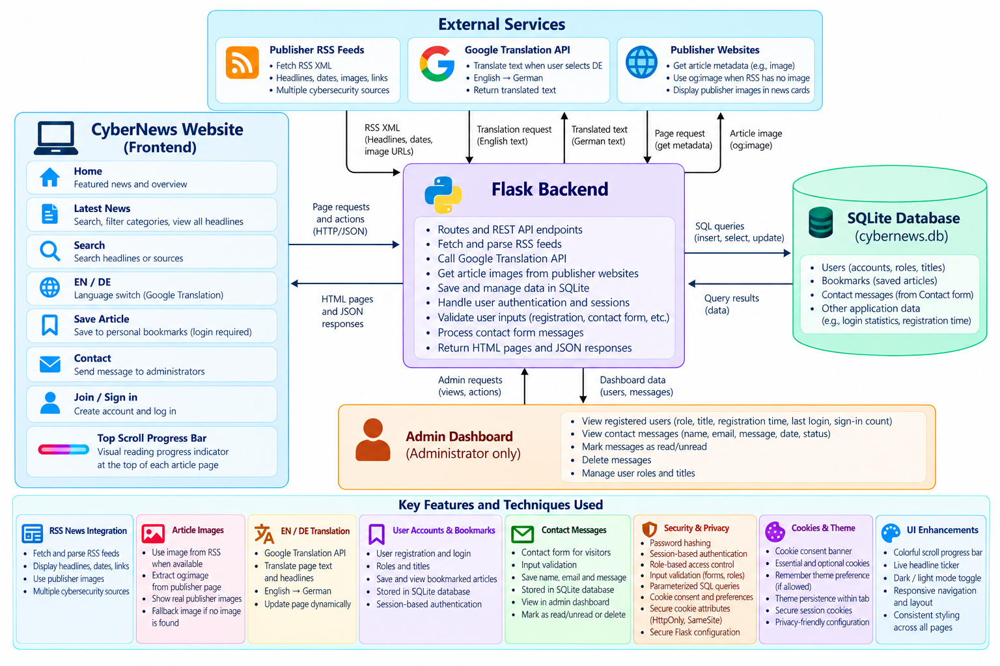
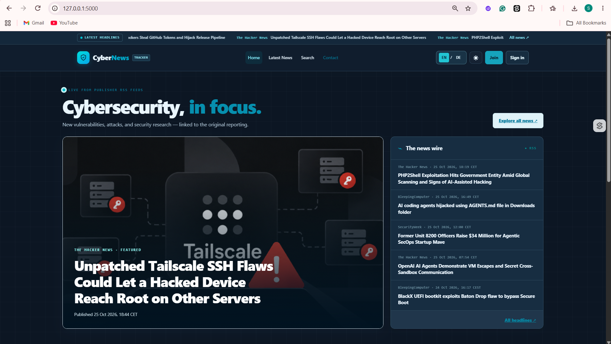
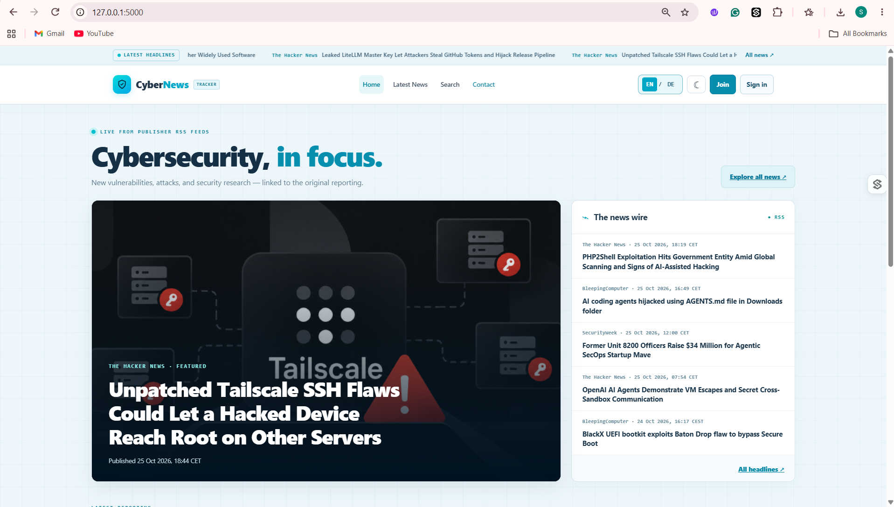
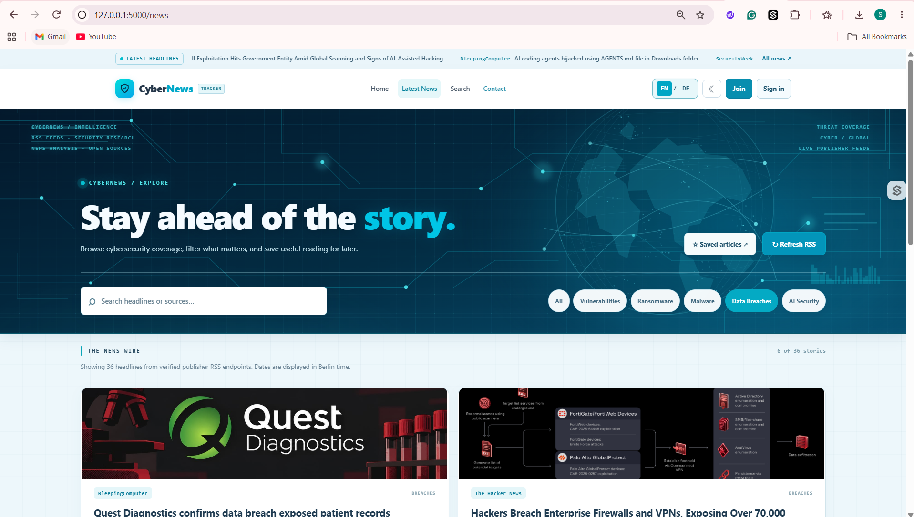
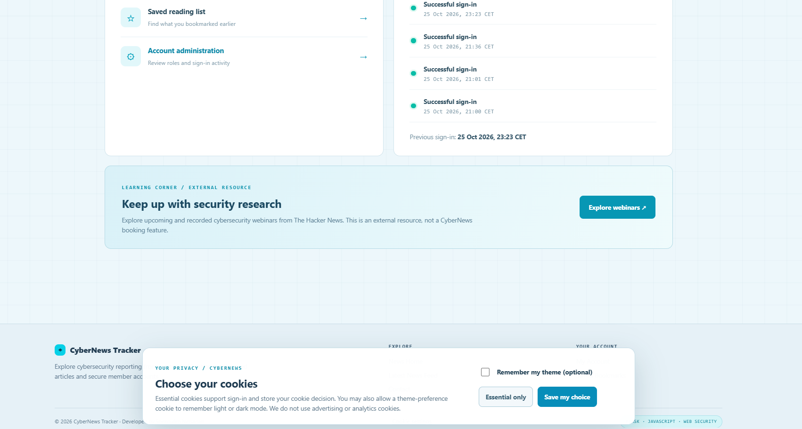
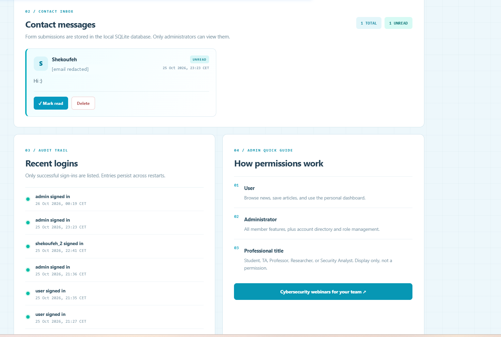

# CyberNews Tracker

A responsive cybersecurity news website built with **Python, Flask, SQLite, HTML, CSS, and JavaScript**. It brings together real publisher headlines, supports English and German, and provides personal bookmarks and an administrator dashboard.

**Developed by Shekoufeh Neisarian**

## Project structure

```text
CyberNews-Tracker/
├── web_app.py                   # Flask routes, RSS, APIs, authentication
├── cybernews_bookmarks.db       # SQLite demonstration database
├── requirements.txt            # Python dependencies
├── templates/                  # 13 HTML/Jinja pages
│   ├── base.html               # Shared layout, navigation and cookie banner
│   ├── index.html              # Home
│   ├── news.html               # Latest News
│   ├── login.html              # Sign in
│   ├── register.html           # Registration
│   ├── user_dashboard.html      # Member account
│   ├── admin_dashboard.html     # Admin Console and Contact inbox
│   ├── bookmarks.html          # Saved stories
│   ├── contact_form.html       # Contact form
│   ├── confirmation.html       # Submission confirmation
│   ├── access_denied.html      # Access denied
│   ├── intelligence.html       # Protected-API demonstration
│   └── cookie_check.html       # Cookie-security demonstration
├── static/
│   ├── style.css               # Responsive design and themes
│   ├── script.js               # Frontend interactions
│   ├── language.js             # Language support
│   ├── language.css
│   └── images/cyber-hero.svg   # Cybersecurity hero artwork
├── docs/
│   └── architecture-and-features.png
├── screenshots/                # 13 screenshots of the application
├── README.md
├── LICENSE
├── .gitignore
└── .env.example                # Example configuration; no real API key
```

## Architecture and features



**At a glance:**

- **News:** RSS headlines from cybersecurity publishers, search and category filters, original article links, publisher preview images, headline ticker and RSS caching.
- **Accounts:** Registration, sign-in, personal dashboard, bookmarks, login activity and role-based access.
- **Admin Console:** Manage user roles and titles; view and manage Contact messages saved in SQLite (read, unread, delete).
- **Interface:** EN/DE language switch, Google-powered translation of live news, light/dark mode, cookie consent, responsive layout and a colorful scroll-progress bar.
- **Security:** Password hashing, session cookies, input validation, parameterized SQL, CSRF checks and access control.

## Run locally (Windows)

**Requirements:** Python 3.10+, Git, an internet connection and a browser.

```powershell
git clone https://github.com/Shekoufeh-Neisarian/CyberNews-Tracker.git
cd CyberNews-Tracker
python -m venv .venv
.\.venv\Scripts\Activate.ps1
python -m pip install -r requirements.txt
python web_app.py
```

Open **http://127.0.0.1:5000** in your browser. Keep the terminal running; press **Ctrl+C** to stop the server.

The repository includes a **SQLite demonstration database** (`cybernews_bookmarks.db`). If it is missing, the application initializes a new one automatically. With a newly initialized database, the default local demonstration accounts are `user / user123` and `admin / admin123`; credentials in an existing database may differ.

### Optional: translate live news into German

The standard interface works without an API key. To translate **dynamic RSS news content**, enable Google Cloud Translation API and set your own key in the **same PowerShell terminal** before starting Flask:

```powershell
$env:GOOGLE_TRANSLATE_API_KEY = "YOUR_OWN_API_KEY"
python web_app.py
```

Do not publish API keys or private user/contact data. This project runs locally using Flask's development server.

## Screenshots

Selected views of the **actual CyberNews application** are shown below. Browse [all 13 screenshots](screenshots/) for other pages, accounts, bookmarks, and language settings.

| Home — Dark mode | Home — Light mode |
| --- | --- |
|  |  |

| Latest News | Cookie consent |
| --- | --- |
|  |  |

**Admin Console — Contact inbox**



The complete [screenshots folder](screenshots/) also includes German translation, sign-in, bookmarks, the member dashboard, user administration, and the Contact form.
